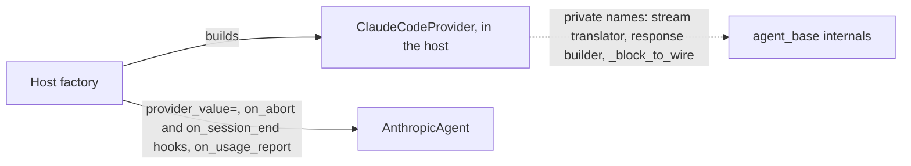
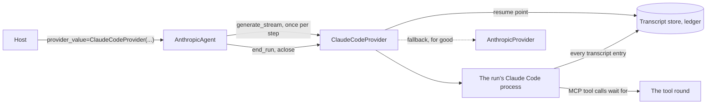

# Claude Code provider

Touches: `agent_base/providers/claude_code/` (new), `agent_base/core/provider.py`, `agent_base/core/runtime.py`, `agent_base/providers/anthropic/anthropic_agent.py`, `agent_base/providers/anthropic/compaction.py`, `agent_base/common_tools/sub_agent_tool.py`, `agent_base/tools/registry.py`, `agent_base/storage/pg/`, `pyproject.toml`, `tests/interface/providers/`, `tests/interface/claude_code_provider/` (new), `mental_model/subsystems/providers.md`, `mental_model/subsystems/turn-loop.md`, `mental_model/subsystems/sub-agents.md`, `mental_model/subsystems/storage.md`, `mental_model/infrastructure/external-services.md`, `mental_model/infrastructure/packaging-and-release.md`, `mental_model/CLAUDE.md`

A second Anthropic transport. `ClaudeCodeProvider` sends a session's model calls through Claude Code, the Claude Agent SDK's CLI, and keeps the direct client (`AnthropicProvider`) as its fallback. Only the model call moves: the [turn loop](../subsystems/turn-loop.md) still runs every tool, pauses for frontend tools, checkpoints and settles. It ships as the optional extra `agent-base[claude-code]`.

> **Why bring it into the library:** so the provider is general, and any host can plug it in in place of the Anthropic provider (the developer, 11 Nov 2026).

Nova's backend built it first, on the existing `provider_value=` seam and with no library change. That build is the reference for this item, and `nova_backend`'s model tells it. The backend's move onto the library's provider crosses repos, so it is planned there.

## Where it sits

Before: the host builds the provider and wires its process's life by hand.



After: one argument. The runtime tells any provider when a run and a session end.



## How a step works

This is the reference build's, with three changes: an error the model API reports through the CLI fails the step typed instead of being missed, a reply cut off mid-stream keeps the CLI's shape of it, and a run keeps its process slot across a restart.

```mermaid
sequenceDiagram
  autonumber
  participant L as Turn loop
  participant P as ClaudeCodeProvider
  participant S as The run's Claude Code process
  participant H as MCP tool handlers
  L->>P: generate_stream with the full history
  P->>S: first step of a run: start, resume at the ledger point, send the user message
  S-->>P: raw Anthropic stream events
  P-->>L: frames on the sink (the library's own translator), then ProviderTurn
  S->>H: one handler call per tool call, each waits
  L->>L: tool round: hooks, registry, externalizer, frames
  L->>P: next generate_stream, with the results
  P->>H: resolve each waiting handler, by the model's tool-call id
  H-->>S: one tool_result per call; the next model call runs on the same process
```

- **What the process is given:** the system prompt, as a file in one working folder; the library's tool schemas, as in-process MCP tools; no Claude Code tools but `WebSearch` and `WebFetch`; no settings files, `CLAUDE.md` files, plugins or auto-compaction; a permission callback that refuses anything else; an environment with secret-looking variables blanked and `ANTHROPIC_API_KEY` empty.
- **A handler finds its call** by the tool-call id Claude Code sends in the MCP request's `_meta` (`claudecode/toolUseId`). Parallel calls each get their own result. A paused run's handlers keep waiting in the live process.
- **One process per run.** It closes after a final reply, on abort, on eviction, and at the end of a run that left tool calls unanswered. At most `max_processes` run at once; a run that finds none free within 15 s is one Claude Code can't carry. A run holds its **slot** from its first model call (or its first compaction summary) to its end: when its process restarts mid-run (a compaction, a failed call, a new tool roster), the slot stays the run's.
- **The two histories.** `context_messages` stays the one that counts. Claude Code's transcript is a copy the CLI needs in order to resume. The **ledger** maps the fingerprint of each point where a model call ended to the transcript entry holding the same point. A run's first step resumes at the longest prefix the ledger knows: a plain resume, a branch (`resume_session_at` + `fork_session`) for a reset or a fork, or a resume at the last point with what follows sent as text, in order. With no point (a reply cut off before its point was recorded, a history edited between runs, a session that ran on the direct client before) or a ledger that fails, a fresh session takes the whole history as text, as after a compaction, and the session stays on Claude Code.
- **The ledger keys the history as the host stores it.** The runtime renders the run's own prompt with what it adds for that run only (memory, a hook's `additional_context`); the next run renders it without them. So the runtime passes the provider `stored_messages=`, the history without those contributions, when the provider asks (`wants_stored_messages`). The CLI still gets the rendered view.
- **The fallback.** A CLI or login failure (the process ending mid-step, the CLI ending the query itself, such as at `max_turns` or without a reply), a refusal from the plan's limit, or no free process slot moves the session to the direct client for good. Before any frame reached a client (always, for a run with no stream attached), the same step runs direct. After frames went out, the step fails and the next one goes direct. `name` becomes `anthropic`, so the run-start stamp of `agent_config.provider` keeps the move. With `fallback="off"` nothing ever reaches the API key; the step fails instead.
- **No step waits for good.** A process that dies ends the step, also while Claude Code runs a web tool; an abort ends that wait too. An abort or a run's end never waits for a ledger point the closed process can't name. A system prompt or tool set that changes mid-run restarts the process. A prompt starting with `/` goes to the CLI with a leading space, so it is never a CLI slash command.
- **An error from the model API is not a fallback.** When the API fails a call, the CLI reports it in the query's result (`is_error`, `terminal_reason`, `api_error_status`), and the step fails with a typed `ProviderError`, as on the direct client. The session stays on Claude Code, with either `fallback` setting; the process ends, and the run keeps its slot.

  | The CLI reports | The step fails with |
  |---|---|
  | `prompt_too_long`, its own `blocking_limit`, HTTP 413 | `CONTEXT_OVERFLOW`: the turn loop compacts and retries, when compaction is on |
  | HTTP 5xx, `server_error` (after the CLI's own retries) | `PROVIDER_OVERLOADED`, retriable |
  | any other refusal (`invalid_request`, `unknown`) | `PROVIDER_STATUS` |

  The CLI's own compaction on a prompt too long is gated on auto-compaction, so it stays off with it (checked in CLI 2.1.321).
- **A reply cut off mid-stream** (a server error, a lost connection) isn't retried from scratch by the CLI. It keeps the reply's finished blocks, drops the block cut midway, and sends its own error message (`server_error`). Then it runs the reply's tool calls, or, with text only, asks the model to resume in a new model call of the same query (checked in CLI 2.1.321). The step follows that shape:

  | The cut reply holds | The step |
  |---|---|
  | A finished tool call | Ends there, with the finished blocks and `tool_use`, so the CLI's handler calls meet the tool round |
  | Text only | Folds the resumed call into the same step, after the finished blocks |
  | Text only, and the CLI doesn't resume | Ends with the finished blocks; an error result fails it typed, as above |

  The client already saw the cut block's text stream; it leaves the history as it leaves the CLI's transcript.

## What moves into the library, and what stays with the host

| Piece | Library | Host |
|---|---|---|
| The provider: process, handlers, stream translation, resume, fallback | `providers/claude_code/provider.py` | — |
| Fingerprint of a history prefix | `providers/claude_code/fingerprint.py` | — |
| Transcript store and ledger | Protocols, in-memory adapters, Postgres adapters and their two tables | Its pool, its principal, its own columns |
| Process slots, the plan's meter | Objects in `ClaudeCodeConfig`, with process-wide defaults | Routing new sessions while the meter warns, if it wants to |
| Web substitutes | Limits taken from `llm_config.server_tools` (`max_uses`); a `url_guard` seam with a default public-address guard | Its own guard, if it has one |
| CLI environment policy | A default set of secret-looking name patterns | Extra patterns |
| Process life | The runtime calls `end_run` and `aclose` ([below](#changes-to-existing-characters)) | — |
| Which sessions get Claude Code, boot checks of its login | — | The host's switch |
| How a Claude Code step is priced | Steps carry `provider="claude_code"` and the 1-hour / 5-minute cache-write split in `raw_usage` | Its `pricing_policy` |
| Transcript retention | `prune_transcripts(pool, days)`, one pass | Scheduling it |

The reference build's couplings to its host are cut at these seams: the MCP server name (`server_name`, which the model sees as `mcp__<server>__<tool>`), the server-tool limits, the URL guard, the secret patterns, and the Postgres tables.

`ClaudeCodeConfig` replaces the reference build's environment-read settings:

```python
ClaudeCodeConfig(
    workdir: Path,                       # one folder for every session, passed as its full path
    server_name: str = "agent_base",     # the MCP server the tools are listed on; the model sees it in every tool name
    fallback: Literal["direct", "off"] = "direct",
    web_tools: bool | None = None,       # None: on when llm_config.server_tools has web_search / web_fetch
    url_guard: UrlGuard | None = None,   # None: the library's public-address guard
    env_blank_patterns: tuple[str, ...] = DEFAULT_SECRET_PATTERNS,
    max_processes: int = 4,
    max_buffer_bytes: int = 64 << 20,    # the SDK's 1 MB default overflows on images
    slots: ProcessSlots | None = None,   # None: the process-wide one
    meter: PlanMeter | None = None,      # None: the process-wide one
)
```

The working folder goes as its full path. On Windows, a short (8.3) path gives the CLI and the SDK different project keys, and a resume from the store misses.

## Changes to existing characters

**[Providers](../subsystems/providers.md): a provider gains an optional lifecycle.** The developer chose this over a helper that wires hooks for the host (11 Nov 2026). It is a separate optional protocol, `ProviderLifecycle`, beside `Provider`, which is unchanged: a `runtime_checkable` protocol checks every member it declares, so new members on `Provider` would make a structural provider without them stop satisfying it. The runtime calls the members through `provider_*` helpers in `core/provider.py`, which treat a missing member as a no-op. The two that end things:

| Member | Called by the runtime | Claude Code does |
|---|---|---|
| `async end_run()` | When the root agent's run ends, after its settlement: a final reply, an abort, the step limit, and the run a steer replaces. Not at a pause | Closes the process once its ledger points are recorded, unless a later step is using it |
| `async aclose()` | When the session ends (eviction, shutdown) | Closes the process; resolves waiting handlers as stopped |

The reference build reaches the same moments through `on_abort` and `on_session_end` hooks and a usage-report callback, which has to tell the root run's report from a sub-agent's. In the runtime that logic lives in one place, for every provider.

**A steer closes the process** (the developer, 11 Nov 2026). The run the steer replaces ends, and so does its process. The new run's process resumes from the ledger, and the cut-off reply goes in as text, by the path an abort mid-stream already takes.

**[Turn loop](../subsystems/turn-loop.md): compaction.** Compaction is the library's own (`providers/anthropic/compaction.py`), on only when a `CompactionConfig` is given: past `threshold_tokens` it keeps the recent part, asks the model to summarize the rest, and replaces that part with one assistant message holding the summary. Claude Code's own auto-compaction stays off, so there is one history. Running the reference build under `AnthropicAgent` with a small `CompactionConfig`, against a scripted stand-in for the CLI, showed the gap:

1. Compaction's summary call goes to `self.provider`, which is this provider. It restarts the run's process and resumes the transcript just to summarize.
2. The rewritten history (the summary plus the recent part) has no ledger point.
3. So the next step falls back, and the session stays on the direct client for good. With the fallback off, the run fails.

**Option A** (the developer, 11 Nov 2026). Compaction stays opt-in on Claude Code, through the same `CompactionConfig` as on the direct client.

1. The compactor makes its summary call through `provider.side_calls()`, a new optional member that returns `self` by default. Claude Code returns a one-shot Claude Code session with no ledger; the run waits for it. The controller is rebuilt at every run start (`initialize_run`), so it asks for `side_calls()` each time it is built.
2. When compaction changed the history, the runtime tells the provider (`history_replaced()`, a new optional member, a no-op by default). `after_compact` also fires when compaction changed nothing, and then nothing happens.
3. Claude Code closes the run's process, which holds the long transcript. Its next step starts a fresh Claude Code session and sends the compacted history as text, in order, with the step's new content. That step's ledger point covers the compacted history from then on, so later runs and a cold load resume it.

Around those steps:

- **Both triggers work.** Past `threshold_tokens`, before a step; and when Claude Code reports a context too long (`CONTEXT_OVERFLOW`, above), after which the step is retried on the fresh session.
- **The summary runs on the run's slot.** When the run's process is open (a compaction between two steps of a run), it ends before the summary starts, once its ledger points are recorded: the compaction replaces its history anyway, and if the compaction leaves the history as it was, the next step resumes it from the ledger. A session never holds two processes, so compaction can't run out of slots mid-run.
- **A failed summary call falls back for that call only.** It runs direct (or fails, with `fallback="off"`), and the next summary tries Claude Code again. While the session itself is on the direct client, summaries go direct too.

Compaction keeps only the recent part, so that text is short. Running this shape offline against the reference build, with hooks standing in for steps 1 to 3, kept the session on Claude Code through a second run and a cold load.

**[Sub-agents](../subsystems/sub-agents.md).** `SubAgentTool` builds every child on `AnthropicProvider`, so on Claude Code a child's model calls go to the direct client. **Children follow the parent's transport** (the developer, 11 Nov 2026): a child of a session on Claude Code runs on Claude Code, not the API key. A new optional `provider.for_child(spec)` builds the child's provider, by default an `AnthropicProvider` with the spec's retry policy, as today. Claude Code returns a new `ClaudeCodeProvider` that shares the parent's store, ledger, slots and meter, or, once the parent's session is on the direct client, the direct client. Each child holds its own process, so it counts against `max_processes`. `SubAgentTool` ends the child's run (`provider_end_run`) however its run ends, so a parent's abort doesn't leave the child's process open.

A parent keeps its slot while it waits for its children, so children run in the slots left: 3 children with `max_processes=2` run one after another, and a child that waits past `slot_wait_s` falls back (or fails, with `fallback="off"`). Releasing the parent's slot while it waits is an open question.

**`AnthropicLLMConfig` on Claude Code.** The CLI takes fewer request fields than the Messages API. A field it can't honour is refused when it changes what the agent can do, and logged once per session when it only tunes the request (the developer, 11 Nov 2026):

| Field | On Claude Code | If set |
|---|---|---|
| `max_tokens` | `CLAUDE_CODE_MAX_OUTPUT_TOKENS` in the CLI's environment | honoured |
| `effort` | `ClaudeAgentOptions.effort`, set when the process starts | honoured |
| `server_tools`: `web_search`, `web_fetch` | Claude Code's `WebSearch` and `WebFetch`, held to their `max_uses` per step by a `PreToolUse` hook | honoured |
| `server_tools`: any other, `skills`, `container_id` | Not passed to the CLI | refused when the provider is built |
| `thinking_tokens`, `beta_headers`, `context_management`, `inference_geo`, `speed`, `service_tier`, `api_kwargs` | Not passed to the CLI | logged once per session |
| `enable_caching=False` | Claude Code always caches, writing for 1 hour | logged once per session |

**[Streaming](../subsystems/streaming.md).** The frames keep their shapes, because the provider runs the library's own translator. Web calls arrive as server-tool frames named `WebSearch` and `WebFetch`, not `web_search` and `web_fetch`, and the history keeps those names. `_plain_history` turns them into text for the direct client, which would reject them.

> **Cross-repo contract:** the wire protocol is consumed by other repos. Before this ships, check the product map, then those repos' Depends on sections and code, for anything keyed on server-tool names.

**[Storage](../subsystems/storage.md).** The library owns the transcript tables: it gains `claude_code_transcripts` and `claude_code_ledger`, with Postgres adapters built like its others (`ColumnSpec`). A host adds its own columns through `extra_columns()` and owner scoping through `principal_columns()`, and gets the tables at boot. `LIBRARY_SCHEMA_VERSION` goes from 6 to 7, with an idempotent migration in the same cut. The reference build's trial tables of the same names are to be removed, so the names stay (the developer, 11 Nov 2026).

> **Why the library owns the tables:** the provider must serve several hosts with different needs, and tables in the library spare each host building them again (the developer, 11 Nov 2026).

**[Packaging](../infrastructure/packaging-and-release.md).** A new extra:

```toml
claude-code = ["claude-agent-sdk==0.2.180", "mcp>=1.28,<2"]
```

- **`claude-agent-sdk` is pinned exactly.** The transcript format is internal to the CLI it bundles, so a bump re-runs the fingerprint, resume and recovery specs.
- **`mcp` stays below 2.** The SDK doesn't bound it. Under `mcp` 2.3.0 the handler's id lookup (`request_ctx`) fails to import, and the provider swallows the error, so every tool call returns "could not be matched to the step". This was hit when installing the SDK into this repo's environment.
- **The Anthropic SDK's stream accumulator** (`anthropic.lib.streaming._beta_messages.accumulate_event`) is pinned with `anthropic`, which is already a dependency.
- **`ClaudeCodeProvider` imports lazily.** Constructing it without the extra raises an actionable `ImportError`, as `mcp_servers=` does.

## Contracts

- **Public names:** `ClaudeCodeProvider`, `ClaudeCodeConfig`, `TranscriptStore`, `TranscriptLedger`, `MemoryTranscriptStore`, `MemoryTranscriptLedger`, `PgTranscriptStore`, `PgTranscriptLedger`, `ProcessSlots`, `PlanMeter`, `prune_transcripts`. Not registered in `PROVIDERS`, like the other providers.
- **`ProviderLifecycle`**, an optional protocol beside `Provider`: `end_run`, `aclose`, `side_calls`, `history_replaced`, `for_child`, and the `provider_*` helpers the runtime calls them through. `Provider` is unchanged. The provider specs in `tests/interface/providers/` pin both.
- **`stored_messages=`**: the runtime passes it to `generate` / `generate_stream` only for a provider whose `wants_stored_messages` is true. It is the history as the next run will render it, the same length as `messages`. Other providers' calls are unchanged.
- **`agent_config.provider`** records the transport a session last ran on (`claude_code`, or `anthropic` after a fallback). A host that picks the provider for a session it loads reads it there.
- **`message.provider`** on each step is `claude_code` for a step Claude Code carried, and `raw_usage.cache_creation` keeps the 1-hour / 5-minute split, so a pricing policy can price the two clients differently.
- **New living spec:** `tests/interface/claude_code_provider/`, offline, against a scripted stand-in for the CLI that calls tools through the real in-process MCP server. A live check against the CLI is marked `integration`.

## Decided

The developer's answers of 11 Nov 2026, folded into the sections above:

- The runtime calls `end_run` and `aclose` on the provider; no hook helper.
- A steer closes the process; the new run resumes from the ledger.
- Sub-agents follow the parent's transport.
- A field Claude Code can't honour is refused when it changes what the agent can do, and logged once when it only tunes the request.
- The library owns the two tables and their Postgres adapters.
- The default MCP server name is `agent_base`. A host whose transcripts were written under another name passes that name, so its resumes keep matching.
- Compaction on Claude Code is option A: the summary through `side_calls()`, then a fresh session from the compacted history. Compaction stays opt-in through `CompactionConfig`.

## Depends on

- **Claude Agent SDK and its bundled CLI, pinned together:** `ClaudeSDKClient`, `session_store`, `resume_session_at`, `fork_session`, `include_partial_messages`, in-process MCP servers, `can_use_tool`, `PreToolUse` hooks, `RateLimitEvent`. Assumes the CLI sends the model's tool-call id in each MCP call's `_meta`, and runs a resumed session's next model call with the tool results its handlers returned.
- **MCP Python SDK below 2:** `mcp.server.lowlevel.server.request_ctx`, read inside a tool handler.
- **Anthropic Python SDK:** the beta stream accumulator, to build the response from Claude Code's raw events.
- **A claude.ai plan's login, for the CLI:** the provider blanks `ANTHROPIC_API_KEY`, so the CLI runs on the login only. The host supplies it, as `CLAUDE_CODE_OAUTH_TOKEN` or a local sign-in. The fallback's direct client uses the host's API key as `AnthropicProvider` always does. See [External services](../infrastructure/external-services.md).
