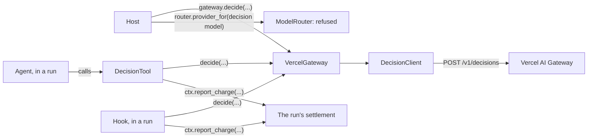
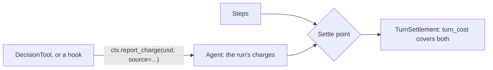

# Decision models

Touches: `agent_base/providers/vercel_gateway/decisions.py` (new), `agent_base/providers/vercel_gateway/gateway.py`, `agent_base/providers/vercel_gateway/__init__.py`, `agent_base/providers/openai_chat/provider.py`, `agent_base/core/model_catalog.py`, `agent_base/providers/router.py`, `agent_base/pricing/models.csv`, `agent_base/tools/context.py`, `agent_base/core/hooks/context.py`, `agent_base/core/runtime.py`, `agent_base/providers/anthropic/anthropic_agent.py`, `tests/unit/providers/vercel_gateway/test_decisions.py` (new), `tests/interface/providers/test_providers_decisions.py` (new), `tests/interface/providers/_two_formats.py`, `tests/interface/pricing_cost/test_pricing_cost_reported_charges.py` (new), `tests/interface/tools/test_tools_context.py`, `tests/interface/agent_loop_hooks/test_agent_loop_hooks_contexts.py`, `tests/integration/providers/vercel_gateway/test_live_vercel.py`, `agent_base/providers/vercel_gateway/vercel_gateway_test.ipynb`, `mental_model/subsystems/providers.md`, `mental_model/subsystems/tools.md`, `mental_model/subsystems/hooks-and-profiles.md`, `mental_model/features/billing-a-run.md`, `mental_model/infrastructure/external-services.md`

A decision model writes no text. It takes an input and typed questions about it, and answers each with probabilities: yes or no, one label from a set, or a level on a scale. Vercel AI Gateway serves them at `POST /v1/decisions`, in OpenAI's Decisions format, which neither the [OpenAI Chat provider](multi-provider-models.md#the-openai-chat-provider-new) nor the turn loop can use: a decision model runs no agent. This item adds:

- **the decision client:** one async call that sends an input and its questions and returns typed answers with Vercel's charge;
- **the decision tool:** through which an agent asks a decision model the host's questions during a run;
- **reported charges:** what a tool or a hook reports it was charged during a run, billed in the run's settlement. A hook that asks a decision model, such as one that gates a tool call, is billed this way.

Builds on [Models from several providers](multi-provider-models.md): the gateway, the model catalog and the price rows. It lands after that item.

## What a decision model is

On Vercel's model list (18 Nov 2026), among others:

| Model | Price per million input tokens | Takes | Notes |
|---|---|---|---|
| `typesafe-ai/jev` | $0.042 | text | TypeSafe AI's; a free-tier account gets a 403 |
| `openai/gpt-6-luna-decisions` | $0.10 | text, images | 1.05M tokens of context |
| `microsoft/decision-1.1`, `google/gemini-decision-1` | $0.042, $0.10 | text; Google's also images and files | |
| `parallel/parallel-decisions-fast` | free | text | looks the input up on the web (its answer cites web pages) |
| `perplexity/pplx-decider-*` | $0.01 to $0.02 | text, images | a per-request web search charge as well |

- **Most charge for input only;** a decision writes almost no output.
- **One request answers several questions** against the same input.
- **The application writes the questions.** In the published uses (Vercel's AI SDK, LangChain's integration, OpenRouter's guides), the questions and their allowed answers are defined in code, and code acts on the answer, usually against a probability threshold. Beside an agent, it is the code around the agent that asks: a yes or no before a tool call runs, or a choice that routes a request.
- **Decision models were called evaluation models** until recently; Vercel's model list still types them `evaluation`. `POST /v1/evaluate` is the deprecated endpoint, and this item doesn't use it.

## Where it sits



- **Not a provider.** A decision is one request and one response, with no history, tools or stream, so it doesn't implement the `Provider` protocol. The turn loop meets it only through a tool or a hook.
- **The router and the gateway refuse a decision model** for an agent or a sub-agent, naming `gateway.decide`.

## The decision client (new)

`DecisionClient` lives with the gateway, in `providers/vercel_gateway/decisions.py`, and `agent_base.providers.vercel_gateway` exports it with its question and answer types. It speaks OpenAI's Decisions format to the base URL it is given. `VercelGateway.decide(...)` calls one built on the gateway's key and shared HTTP client, which `gateway.aclose()` closes as before.

```python
decision = await gateway.decide(
    "typesafe-ai/jev",
    input="I was charged twice for my subscription.",
    questions=[
        Predicate("refund", "Is the customer asking for money back?"),
        Choice("queue", "Which team should handle this?",
               {"billing": "refunds and payments", "shipping": "delivery and damaged items"}),
        Score("urgency", "How urgent is this?", ["low", "medium", "high"]),
    ],
)
decision["refund"].probability   # 0.98
decision["queue"].choice          # "billing"
decision.cost                     # Vercel's charge, in USD
```

### Questions and answers

| Question | Sent as | Answer |
|---|---|---|
| `Predicate(name, instructions)` | `{"type": "predicate", "name", "instructions"}` | `PredicateAnswer`: `probability` of yes |
| `Choice(name, instructions, choices)`: 1 to 255 choices, each a value (a string or a bool) and an optional description | `choices: [{"value", "description"}]` | `ChoiceAnswer`: `choice`, `confidence`, `probabilities` by value |
| `Score(name, instructions, levels)`: 2 to 10 levels, lowest first, each a label and an optional description | `levels: [{"label", "description"}]` | `ScoreAnswer`: `score` (the probability-weighted level index, from 0), `confidence`, `probabilities` by label |
| any | | `Refusal(name)` where the model declined that question; the others are answered |

- **Every question has a unique name,** and `Decision` gives each answer by its question's name. The endpoint allows unnamed questions; the client doesn't.
- **`confidence` and `probabilities` are `None`** when the answering model returns none.

### The input

| The host gives | Sent as |
|---|---|
| a `str` | `input` as a string |
| a dict, or a list of dicts | one user message with an `input_json` part |
| a list of `str`, `TextContent`, `ImageContent` and dicts | one user message whose parts keep that order: `input_text`, `input_image` (a base64 data URL), `input_json` |

- **Images follow the model's record,** as PDFs do on the chat route: refused before sending where the record lists no image input (`typesafe-ai/jev` answers those with a 400), sent with one warning (`decision_images_unverified`) where the model has no record.
- **An image by URL or Files API id is refused:** the endpoint takes base64 data URLs only, up to 128 a request.

### Options

| Option | Sent as |
|---|---|
| `fallback_models` | `providerOptions.gateway.models`. A decision model or a language model, which answers through structured output |
| `zero_data_retention=True` | `providerOptions.gateway.zeroDataRetention` |
| `provider_options` | merged last, for anything else the gateway takes, such as a conditional fallback that reruns an uncertain decision on another model |

### The result

```python
Decision(
    answers: dict[str, Answer],  # by question name, in question order
    model: str,                  # the model that answered
    usage: Usage,                # input_tokens, output_tokens
    cost: float | None,          # Vercel's charge; else the row's price; else None
    generation_id: str | None,   # the key to the call in Vercel's logs
    raw: dict,                   # the whole response, e.g. Parallel's citations in provider_metadata
)
```

### Errors and retries

The OpenAI Chat provider's own error handling, shared rather than copied: reading an error response and classifying it (today `_api_error` and the provider's `classify_error` method) become functions in `openai_chat/provider.py` that both call. A failure is raised as `DecisionError` with its `ErrorCode`, the response's `message`, and its `param` (the field that failed validation):

| Failure | `ErrorCode` |
|---|---|
| 429 | `RATE_LIMITED`, retried |
| 500, 502, 503, 504 | `PROVIDER_OVERLOADED`, retried |
| Timeout, connection error | `PROVIDER_TIMEOUT`, retried |
| 400 (`invalid_request_error`), 403 (such as a free-tier account on JEV), other status errors | `PROVIDER_STATUS` |

Retries follow a `RetryPolicy`, the default one unless the call passes its own. An input over the model's context window is a `PROVIDER_STATUS` error: with no conversation, there is nothing to compact.

## The decision tool (new)

`DecisionTool`, also in `providers/vercel_gateway/decisions.py`, is a `ConfigurableToolBase` that a host builds and registers like any other tool. The host fixes the model and the questions; the agent gives only the input and never writes a question.

```python
triage = DecisionTool(
    gateway,
    name="triage_ticket",
    description="Decide how a support ticket is routed.",
    model="typesafe-ai/jev",
    questions=[Predicate("refund", ...), Choice("queue", ...), Score("urgency", ...)],
)
```

- **What the agent passes:** `input`, the text to decide on. The tool's description lists its questions, so the agent knows what it will learn.
- **What the agent gets back:** one line per question, and no cost:

  ```text
  refund: yes (0.98)
  queue: billing (0.97); shipping 0.03
  urgency: high (score 1.9; low 0 to high 2)
  ```

  A question the model declined reads `refund: declined`. The conversation log gets the same text.
- **A failed decision** (a `DecisionError`, after the client's retries) is an error result carrying its message, and the run carries on.
- **Each call is one paid request.** The input is text the agent writes, so the agent's own output limit bounds its size. How many calls a run makes is bounded as for any tool: by `max_steps`, when the agent has one (`None` means no limit).
- **In a sub-agent,** the charge joins the sub-agent's own settlement, as its steps do.

## Decisions in hooks

The common use beside an agent, the code around it asking, is a [hook](../subsystems/hooks-and-profiles.md) that calls `gateway.decide` and acts on the answer:

| Use | Hook | What the hook does with the answer |
|---|---|---|
| Gate a tool call | `before_tool` | Blocks the call below a threshold |
| Route a request | `on_turn_start` | Switches profile, or blocks the run |
| Check a result | `after_tool` | Replaces the result |

- **`HookContext` gains `report_charge(usd, *, source)`,** so a hook's decision is billed in the run's settlement, as a tool's is. The library ships no such hook; the host writes it.
- **A hook with no run** (`run_id` is `None`, as in `on_session_start` and `on_session_end`) has nothing to bill against: `report_charge` raises there, and the host bills that decision itself, as for `gateway.decide` outside a run.
- **`on_turn_end` and `on_abort` fire before their run's settle point,** so their charges are billed.
- **A sub-agent's hooks** report into the sub-agent's settlement; `on_subagent_start` and `on_subagent_end` fire on the parent and report into the parent's.

## Billing

### Outside a run: the host bills

A call to `gateway.decide` outside any run is covered by no settlement. `Decision.cost` is what the host bills:

1. Vercel's charge, from `provider_metadata.gateway.cost` (a decimal string in USD). Where a conditional fallback reran the decision, both calls are billed, and the charge and `usage` cover both.
2. Without one, the model's row in `pricing/models.csv`, priced by `calculate_step_cost` from `usage`, by exact id like the gateway's chat rows. Each catalogued decision model gets a row (input rate only, for most).
3. Without either, `None`, with `unknown_model_for_cost` logged.

### Inside a run: the run bills

A tool or a hook reports what it was charged, and the next settle point bills it with the agent's steps.



1. **`report_charge(usd, *, source)`, on `ToolContext` and `HookContext`.** The decision tool calls it with `Decision.cost` and its own name; a hook calls it with whatever source the host names. A decision with no cost (`None`) reports nothing, and `unknown_model_for_cost` is logged, as for a step on an unlisted model. An unwired `ToolContext` raises, as `emit` does.
2. **The agent keeps the run's charges beside its steps,** with a settled count of its own, as the watermark does for steps. Each is logged as `charge_reported` with its source, amount and run, and the tool call where there is one.
3. **A settle point adds the unbilled charges to `turn_cost`:** to `total_cost`, and as `breakdown["charges"]`. `turn_usage` and `model` stay the agent's own; a decision's tokens aren't added to them. `pricing_policy` doesn't reprice a charge.
4. **A pause stores unbilled charges on the pause record,** in the same priced spend as the steps, so a cold resume bills them.
5. **`Conversation.cost` includes them,** and a sub-agent's charges are forwarded up the tree with its steps' cost.

Rules:

- **A run whose tools and hooks report no charge settles exactly as it does today.**
- **An errored run writes off its charges** with its steps.
- **A charge reported after the run's last settle point isn't billed,** such as a decision still running when an abort settles. It is logged as `charge_unbilled`. A later settlement with no new steps would carry the same `(run_id, agent_id, step_count)` as the one before it, which a ledger that dedupes on that key drops.

## Changes to existing characters

**[Model catalog](multi-provider-models.md#the-model-catalog-new):** `ApiFormat` gains `"decisions"`. A decision model's record is how the router, the gateway and the decision client tell one apart: its id has the same `creator/model` form as a chat model's, so without a record it routes to Chat Completions by rule, where Vercel refuses it. As for chat models, a record ships once the model's live check has run.

**[Model router](multi-provider-models.md#the-model-router-new) and [Vercel AI Gateway](multi-provider-models.md#vercel-ai-gateway-new):** `provider_for` refuses a model whose record says `"decisions"`, with an error naming `gateway.decide`; `VercelGateway` gains `decide`. `decide` refuses a model whose record names another format. It sends a model with no record, with one warning (`decision_model_unrecorded`), as it sends images for such a model.

**[OpenAI Chat provider](multi-provider-models.md#the-openai-chat-provider-new):** its error reading and classification become functions the decision client shares. What the provider does with an error is unchanged.

**[Tools](../subsystems/tools.md):** `ToolContext` gains `report_charge`, which the agent wires for each call as it wires `emit`.

**[Hooks](../subsystems/hooks-and-profiles.md):** every hook context gains `report_charge`, in the base field set the runtime stamps beside `emit` and `once`. With no run, it raises.

**[Billing a run](../features/billing-a-run.md):** a settlement's `turn_cost` covers the charges its tools and hooks reported as well as the agent's steps. No field changes shape, and the pause record stores the same priced spend it does today.

## Testing it now

- **A free-tier account can call `parallel/parallel-decisions-fast`** (18 Nov 2026, $0). Given a review ("The soup was cold and the waiter ignored us for an hour"), it chose sentiment `negative` at 0.997 and answered the complaint predicate at 0.973. Its answer cited web pages, so it looks its input up on the web: made-up input only.
- **JEV refuses a free-tier account** with a 403 (`RestrictedModelsError`). A live check on JEV needs purchased credits; one check of a few hundred input tokens costs well under a cent.
- **JEV stays offline-only for now** (decided 19 Nov 2026): no record and no price row until its live check runs. Meanwhile:
  - `decide` still sends it, with the `decision_model_unrecorded` warning, and its cost is Vercel's charge alone;
  - the router sends it to Chat Completions by rule, where Vercel refuses it;
  - a host can add its own record with `catalog.add`.
- **The client, offline,** in `tests/unit/providers/vercel_gateway/test_decisions.py` and `tests/interface/providers/test_providers_decisions.py`, against a `/v1/decisions` route added to the scripted gateway stand-in: each question type, each input form, refusals, missing confidence, the errors, retries and the charge.
- **Reported charges, offline,** in `tests/interface/pricing_cost/test_pricing_cost_reported_charges.py`:
  - a tool's charge in the run's settlement, and a `before_tool` hook's;
  - charges split across two legs;
  - one stored on a pause and billed after a cold resume;
  - written off in an errored run;
  - reported after an abort's settle, and not billed;
  - a sub-agent's in its own settlement;
  - a run with no charges settling as today.
- **The contexts:** `test_tools_context.py` gains `report_charge` unwired; `test_agent_loop_hooks_contexts.py` gains `report_charge` in a run and raising with none.
- **Live,** in `tests/integration/providers/vercel_gateway/`, with `AGENT_BASE_LIVE_VERCEL=1`: one decision on Parallel Decisions Fast, and one agent run on a gateway chat model that calls a `DecisionTool` on it. Parallel charges $0, so the run checks the path, not the amount; a nonzero charge needs a paid decision model, such as JEV, once the account has credits.
- **The notebook** `vercel_gateway_test.ipynb` gains a decisions section.
- **UAT:** with no decision tool or deciding hook registered, nothing a run sends or settles changes. UAT applies once a host registers one.

## Phases

1. `DecisionClient`, `VercelGateway.decide`, the catalog's `"decisions"` format and records, price rows, the shared error handling, the client's tests and the notebook section. Live on Parallel Decisions Fast. JEV's live check, record and price row wait for purchased credits.
2. `DecisionTool`, `report_charge` on `ToolContext` and `HookContext`, charges in the settlement, their specs and the live agent run.

Both phases are in this item; phase 2 needs phase 1's client.

## Open questions

None.

## Contracts

- **New public names,** exported from `agent_base.providers.vercel_gateway`: `DecisionClient`, `DecisionTool`, `Decision`, `Predicate`, `Choice`, `Score`, `PredicateAnswer`, `ChoiceAnswer`, `ScoreAnswer`, `Refusal`, `DecisionError`; `VercelGateway.decide`. Also `ToolContext.report_charge` and `HookContext.report_charge`.
- **`ApiFormat`** gains `"decisions"`.
- **`ModelRouter.provider_for`** and **`VercelGateway.provider_for`** refuse a catalogued decision model.
- **`TurnSettlement.turn_cost`** covers the charges tools and hooks report. Every field keeps its shape, and a run with no charges settles as today. A host that bills `turn_cost.total_cost` bills reported charges with no change to its ledger.
- Every change is additive. Nova consumes this package and changes nothing until it registers a `DecisionTool`, reports a charge from a hook, or calls `decide`, which it would plan in its own repo.

## Depends on

- **Vercel AI Gateway:** `POST /v1/decisions` under `https://ai-gateway.vercel.sh/v1`, in OpenAI's Decisions format, with the gateway key. Assumes the answers come back in question order, each with its question's name; that `provider_metadata.gateway.cost` is the charge in USD on the gateway's own key (the docs show no `is_byok` flag here, unlike Chat Completions' `usage`; the live check on Parallel confirms the field, and a nonzero amount waits for a paid check); and that a decision model can't be called through Chat Completions.
