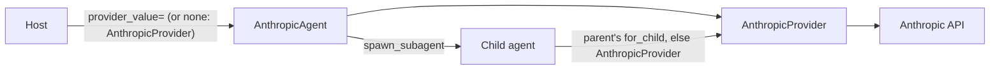
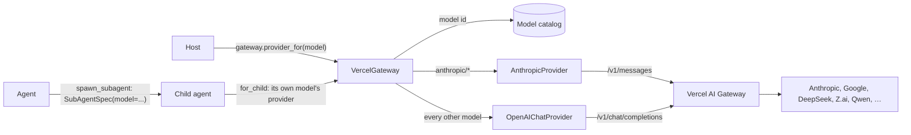

# Models from several providers

Touches: `agent_base/providers/openai_chat/` (new), `agent_base/providers/vercel_gateway/` (new), `agent_base/core/model_catalog.py` (new), `agent_base/providers/__init__.py`, `agent_base/providers/anthropic/anthropic_agent.py`, `agent_base/common_tools/sub_agent_tool.py`, `agent_base/pricing/models.csv`, `agent_base/pricing/calculator.py`, `pyproject.toml`, `.env.example`, `tests/unit/providers/openai_chat/` (new), `tests/unit/providers/vercel_gateway/` (new), `tests/interface/providers/`, `tests/integration/providers/vercel_gateway/` (new), `mental_model/subsystems/providers.md`, `mental_model/subsystems/sub-agents.md`, `mental_model/features/billing-a-run.md`, `mental_model/infrastructure/external-services.md`, `mental_model/infrastructure/packaging-and-release.md`

Today every agent's model calls go to Anthropic, directly or through Claude Code; [LiteLLM](../subsystems/providers.md#litellm) reaches other models with known gaps. This item lets an agent, or one of its sub-agents, run on any model Vercel AI Gateway serves and keep everything the harness does: tools, pauses, aborts, compaction, sub-agents, frames and settlement. Only the [provider](../subsystems/providers.md) changes. Claude keeps the Anthropic format; every other model goes through one new provider for the OpenAI Chat Completions format, which the gateway translates to each model's own API. A model catalog tells the harness which format serves each model.

> **Why:** to plug in sub-agents for specific jobs, such as summarization or classification, on whichever model suits them, and use them as is (the developer, 17 Nov 2026).

> **Why a gateway that translates:** the sub-agents' models need chat only, and one interface keeps the operational effort from growing as models are added. The cost is less control over each provider's own settings (the developer, 18 Nov 2026).

> **Why Claude stays on the Anthropic format:** the library already has that interface, and it carries Claude's own settings (the developer, 18 Nov 2026).

This replaces the direction of 17 Nov: a native provider per API, reached through OpenCode Console. Its prototype (commit `ce1bab7` on branch `saanvi/opencode-console-provider`) built a Console route, a native Gemini provider and the model catalog. The Console route has since been removed from the branch. The Gemini provider is not needed now (the developer, 18 Nov 2026) and stays until open question 3 is settled; the catalog carries over.

## Where it sits

Before: the host picks the provider by hand, and a sub-agent runs on Anthropic unless its parent's provider says otherwise.



After: the gateway holds the keys and serves every model; the catalog picks the format.



A child keeps its own history, so one model's reasoning never reaches another model.

## The model catalog (new)

One record per model, keyed by the gateway's id (`google/gemini-3.8-flash`, `anthropic/claude-haiku-5.5`). The prototype's `core/model_catalog.py` carries over, with the gateway id as the key.

```python
ModelRecord(
    id: str,                     # the gateway's id: "creator/model"
    api: ApiFormat,              # "anthropic" or "chat_completions"
    context_tokens: int | None,  # left unset until checked
    output_tokens: int | None,
    inputs: frozenset[str],      # "text", "image", "pdf"
    reasoning: bool,
    zero_data_retention: bool,   # as the gateway's catalogue flags it
)
```

- **Format by rule:** `anthropic/*` is the Anthropic format; every other model is Chat Completions. A record overrides the rule.
- **A field a model can't honour** follows the rule the [Claude Code provider](claude-code-provider.md) set: refused when the provider is built if it changes what the agent can do (an Anthropic server tool on a non-Claude model), logged once per session if it only tunes the request.

## The OpenAI Chat provider (new)

`OpenAIChatProvider` and `OpenAIChatLLMConfig`, in `providers/openai_chat/`, for the OpenAI Chat Completions format. It implements the `Provider` protocol, which is unchanged, and speaks plain HTTP through `httpx` (no new dependency: `httpx` comes with the Anthropic SDK). It serves any endpoint of that format: the gateway, a model a host runs itself, or a local server such as Ollama. The history stays in the harness's own blocks, and the provider translates at the edge:

| The harness | Chat Completions |
|---|---|
| System prompt | the first message, role `system` |
| `TextContent`, `ImageContent` | `content` parts: `text`, `image_url` (a data URL for base64) |
| `DocumentContent` | a `file` part where the model's record lists PDF input; refused otherwise |
| `ThinkingContent` | the response's `reasoning` text; its `reasoning_details` entries kept in the block's `kwargs` and sent back unchanged, only to the model that wrote them |
| `ToolUseContent` | `tool_calls`: `id`, `function.name`, `function.arguments` as a JSON string |
| `ToolResultContent` | a `tool` message with `tool_call_id`; images it returned go in a user message after it |
| Tool schemas | `tools`: `{type: "function", function: {name, description, parameters}}` |
| `effort` | `reasoning.effort` (`none` to `max`); `thinking_tokens` is `reasoning.max_tokens` |
| `max_tokens` | `max_tokens` |
| Structured output | `response_format` with a JSON schema |
| Usage | `prompt_tokens`, `completion_tokens`, `prompt_tokens_details.cached_tokens`, `completion_tokens_details.reasoning_tokens` |
| Finish reason | `stop` → `end_turn` (`tool_use` when calls came back), `tool_calls` → `tool_use`, `length` → `max_tokens`, `content_filter` → `refusal` |

**Stream translation** produces the frames the Anthropic provider does: `text` from `delta.content` and `thinking` from `delta.reasoning` as they arrive, with one closing frame per block; tool-call arguments are buffered by index, and one `tool_call` frame per call goes out when the call is complete.

**A failure mid-stream:** before any frame went out, the call is retried; after, the provider keeps what streamed and returns it with `partial_error`, so the client never sees the same text twice.

**Errors and retries:**

| Failure | `ErrorCode` |
|---|---|
| 429 | `RATE_LIMITED`, retried |
| 500, 502, 503, 504 | `PROVIDER_OVERLOADED`, retried |
| Timeout, connection error | `PROVIDER_TIMEOUT`, retried |
| 400 for a prompt over the context window | `CONTEXT_OVERFLOW`: the turn loop compacts and retries |
| Other status errors (`{"error": {"message", "type", "code"}}`) | `PROVIDER_STATUS` |

## Vercel AI Gateway (new)

`VercelGateway`, in `providers/vercel_gateway/`: the gateway's key and base URL, and `provider_for(model)`.

- **Two formats, one key.** Claude goes to `https://ai-gateway.vercel.sh/v1/messages` through `AnthropicProvider` with the gateway as its base URL; every other model goes to `https://ai-gateway.vercel.sh/v1/chat/completions` through `OpenAIChatProvider`. Both send `AI_GATEWAY_API_KEY` (`x-api-key` or `Authorization: Bearer`).
- **Gateway settings** ride the request where a host sets them: fallback models (`models`), provider order (`providerOptions.gateway.order`), automatic prompt caching (`providerOptions.gateway.caching: "auto"`).
- **Sub-agents:** each provider the gateway builds has `for_child(spec)`, which returns the provider for the spec's model. A Gemini or DeepSeek child runs under a Claude parent, all through the gateway. A spec with no model stays on its parent's format, never on a direct API key.
- **One HTTP client per format,** shared by every provider the gateway builds; the host closes them with `gateway.aclose()`.
- **Each step keeps the gateway's generation id** (the response's `id`) in `usage_kwargs`, the key to its cost and log in Vercel.
- **Set up from the environment** with `VercelGateway.from_env()`: `AI_GATEWAY_API_KEY`.

What the gateway gives beside the calls: request logs, cost per request and budgets in its dashboard; fallbacks across providers; zero data retention flagged per model; and Private Inference, which adds a host's own model server (a public HTTPS endpoint) at $0.20 per 1,000 requests.

## Changes to existing characters

**[Providers](../subsystems/providers.md):** a second protocol implementation for every non-Claude model. `AnthropicProvider` is unchanged; through the gateway it only gets another base URL and key. Resolution from the model alone, without `provider_value=`, waits for phase 3: the host passes `provider_value=gateway.provider_for(model)`.

**[Sub-agents](../subsystems/sub-agents.md): a child's model picks its provider,** through the gateway providers' `for_child`. `SubAgentTool` is unchanged.

**[Billing a run](../features/billing-a-run.md):** gateway steps carry the gateway's model id (`google/gemini-3.8-flash`), which `pricing/models.csv` doesn't have, so they cost zero until the pricing question below is settled. The table has no `claude-haiku-5-5` row today either.

**[Compaction and externalization](../subsystems/turn-loop.md):** unchanged. The summary call goes through the provider's `side_calls()`, so a child on another model summarises on that model. Token estimation on Chat Completions starts with the character heuristic the other non-Anthropic providers use.

**[Packaging](../infrastructure/packaging-and-release.md):** no new extra. `httpx` should become a direct dependency, since the library now imports it itself.

## Testing it now

- **Models free per token,** all with tool calling: `reflection/beam-free`, `nvidia/nemotron-3.5-lightning-free`, `recursive/flint-v1.0`, `humansand/ampersand-v0.1`, `stealth/glyph-cluster`. None has zero data retention, so they take made-up data only.
- **The free tier's $5 a month** covers the models Vercel marks as free-tier eligible, with lower rate limits per model. Buying credits ends the monthly $5.

## The conformance tier

One spec that every provider passes, so "supported" means the same thing for every model.

| Behaviour | Checked |
|---|---|
| A plain reply, streamed | Frames in order, the final message, usage |
| A tool round, parallel tool calls, a tool error | Results matched to calls by id |
| A second run replaying the first run's reasoning and calls | Accepted by the model |
| A frontend tool's pause and resume | The run resumes with the reply |
| An abort mid-stream | `plan_stream_abort` keeps what it should |
| A prompt over the context window | `CONTEXT_OVERFLOW`, then compaction and a retry |
| A sub-agent on another model | The child's answer and settlement reach the parent |
| An image input, structured output | Where the model's record says it can |
| A rate limit, a server error | Retried within the `RetryPolicy` |

- **Offline,** in `tests/unit/providers/` and `tests/interface/providers/`, against a scripted stand-in for each format.
- **Live,** in `tests/integration/providers/vercel_gateway/`, marked `integration`: `AGENT_BASE_LIVE_VERCEL=1` runs the checks on the free models; a second flag adds Claude and paid models, which spend credits. A model's record ships once its live tier passes.

## Phases

1. The catalog keyed by gateway ids, `OpenAIChatProvider`, `VercelGateway` with Claude on the Messages endpoint, sub-agent resolution and the conformance tier. Live on two free models, then a cheap paid one and `anthropic/claude-haiku-5.5`.
2. Settlement priced from what the gateway charged; traces from the harness to Langfuse (the gateway's own trace export carries metadata only, not prompts or responses).
3. Resolution from the model without `provider_value=`; the Responses format and a native Gemini provider, if a model needs what Chat Completions can't carry.

## Open questions

For the developer, before the build:

1. Claude as the main agent: through the gateway's Messages endpoint, or direct to Anthropic? Vercel documents `thinking`, `cache_control` and web search on that endpoint, but not `context_management`, and gives the cache lifetime as 5 minutes.
2. Why Vercel over OpenRouter? This item should record the reason.
3. The prototype's native Gemini provider: remove it with the Console code, or keep it for a direct Gemini key?
4. Pricing gateway steps: add rows to `pricing/models.csv` at the gateway's list price, or read the charge from the gateway's generation lookup (`GET /v1/generation?id=`), which is filled in asynchronously and can 404 for a while?
5. A model with no catalog record: refuse it, or use the format rule alone?
6. LiteLLM and the any-llm stub (`providers/any_llm/`, every behaviour still `NotImplementedError`): keep, or remove now that `OpenAIChatProvider` covers other models?
7. Production sub-agents: only models flagged for zero data retention?

## Contracts

- **New public names:** `OpenAIChatProvider`, `OpenAIChatLLMConfig`, `VercelGateway`, `ModelRecord`, `ModelCatalog`.
- **`SubAgentSpec.model`** now also picks the child's provider, through the gateway.
- **`Provider`** and `ProviderLifecycle` are unchanged.
- Every change is additive for a host that passes `provider_value=` or uses Claude only. Nova consumes this package; it changes nothing until it puts a sub-agent on a gateway model, which it would plan in its own repo.

## Depends on

- **Vercel AI Gateway:** Chat Completions at `/v1/chat/completions` and Anthropic Messages at `/v1/messages` under `https://ai-gateway.vercel.sh`, the gateway key, and the generation lookup. Assumes `reasoning_details` sent back unchanged keeps a model's reasoning valid across turns (undocumented; the live tier checks it), and that the stream follows OpenAI's chunk format.
- **Anthropic Python SDK**, unchanged; the gateway is its base URL.
