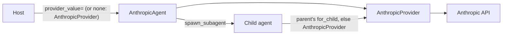
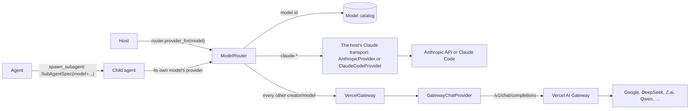

# Models from several providers

Touches: `agent_base/providers/openai_chat/` (new), `agent_base/providers/vercel_gateway/` (new), `agent_base/providers/router.py` (new), `agent_base/core/model_catalog.py` (new), `agent_base/core/provider.py`, `agent_base/providers/__init__.py`, `agent_base/providers/anthropic/anthropic_agent.py`, `agent_base/common_tools/sub_agent_tool.py`, `agent_base/pricing/models.csv`, `agent_base/pricing/calculator.py`, `pyproject.toml`, `.env.example`, `tests/unit/providers/openai_chat/` (new), `tests/unit/providers/vercel_gateway/` (new), `tests/unit/providers/test_model_router.py` (new), `tests/interface/providers/` (the conformance tier and the new parts' specs), `tests/interface/pricing_cost/test_pricing_cost_gateway_charge.py` (new), `tests/integration/providers/vercel_gateway/` (new), `agent_base/providers/vercel_gateway/vercel_gateway_test.ipynb` (new), `agent_base/providers/openai_chat/openai_chat_agent_test.ipynb` (new), `mental_model/subsystems/providers.md`, `mental_model/subsystems/sub-agents.md`, `mental_model/features/billing-a-run.md`, `mental_model/infrastructure/external-services.md`, `mental_model/infrastructure/packaging-and-release.md`

Today every agent's model calls go to Anthropic, directly or through Claude Code; [LiteLLM](../subsystems/providers.md#litellm) reaches other models with known gaps. This item lets an agent, or one of its sub-agents, run on any model Vercel AI Gateway serves and keep everything the harness does: tools, pauses, aborts, compaction, sub-agents, frames and settlement. Only the [provider](../subsystems/providers.md) changes. Claude keeps the Anthropic format and its two transports, direct or through Claude Code. Every other model goes through one new provider for the OpenAI Chat Completions format, which the gateway translates to each model's own API. A model router picks which of the two serves each model, for an agent and for each of its sub-agents; a model catalog tells it which format a model speaks.

> **Why:** to plug in sub-agents for specific jobs, such as summarization or classification, on whichever model suits them, and use them as is (the developer, 17 Nov 2026).

> **Why a gateway that translates:** the sub-agents' models need chat only, and one interface keeps the operational effort from growing as models are added. The cost is less control over each provider's own settings (the developer, 18 Nov 2026).

> **Why Claude stays on the Anthropic format:** the library already has that interface, and it carries Claude's own settings (the developer, 18 Nov 2026).

> **Why Claude goes through Anthropic only:** Claude already has two transports, the direct API and Claude Code, chosen between for cost; Vercel is added for more and cheaper models. A Claude route through Vercel would be one more interface nobody uses. Each provider keeps one place: Anthropic for Claude, Vercel for the OpenAI format (the developer, 18 Nov 2026).

> **Why Vercel AI Gateway rather than OpenRouter:** no fee on credits, free models the harness can call through the API, and lower prices on open models (the developer, 18 Nov 2026).

This replaces the direction of 17 Nov: a native provider per API, reached through OpenCode Console. Its prototype (commit `ce1bab7` on branch `saanvi/opencode-console-provider`) built a Console route, a native Gemini provider and the model catalog. The Console route and the Gemini provider have since been removed (Gemini is not needed now, the developer, 18 Nov 2026); the catalog carries over. Phase 1's first build also sent `anthropic/*` ids to Vercel's Messages endpoint; that route was removed the same day, for the reason above.

**Prototype status (18 Nov 2026):** phase 1 is built on the same branch, ahead of this item's review, at the developer's request. Offline tests pass against scripted stand-ins for both formats. The live tier passed on the two free models a free-tier account can call (a streamed reply, a tool round replayed with its reasoning, a classification, a refused model). The paid checks were refused: GLM 5.3 Flash and Gemini 3.1 Flash-Lite answer a free-tier account with a 403, so they wait for purchased credits. The conformance tier passes offline for both formats (`tests/interface/providers/`), with specs for the router, the gateway, the OpenAI Chat provider, the catalog and the gateway's charge; a notebook walks through the route (`vercel_gateway_test.ipynb`), and another runs the agent end to end on the gateway's free models (`openai_chat_agent_test.ipynb`: tools, resume, answer check, structured output, reasoning, a pause, sub-agents, compaction, externalization, abort and steer, the bill; 29 of 29 checks passed live). The tool check and `tool_choice` are built and pass offline; the live tool round runs with failed checks lifted, so a model marked `tools=False` can be checked again.

## Where it sits

Before: the host picks the provider by hand, and a sub-agent runs on Anthropic unless its parent's provider says otherwise.



After: the model's id picks the route. Claude goes to the host's Claude transport; every other model goes through the gateway.



A child keeps its own history, so one model's reasoning never reaches another model. The parent and the child exchange only the task and the answer, as text, so the two formats never mix in one history.

## The model catalog (new)

One record per model, keyed by the id the host names: Anthropic's own id for Claude (`claude-sonnet-5-5`), the gateway's id for every other model (`google/gemini-3.8-flash`). The records hold the limits and data-retention flag Vercel's catalogue lists.

```python
ModelRecord(
    id: str,                     # Anthropic's id for Claude; the gateway's "creator/model" otherwise
    api: ApiFormat,              # "anthropic" or "chat_completions"
    context_tokens: int | None,  # left unset until checked
    output_tokens: int | None,
    inputs: frozenset[str],      # "text", "image", "pdf"
    reasoning: bool,
    zero_data_retention: bool,   # as the gateway's catalogue flags it
    tools: bool | None,          # the live tier's tool round: True passed, False failed, None not run
)
```

- **Format by rule:** `claude-*` is the Anthropic format; any other `creator/model` id is Chat Completions. A record overrides the rule. `anthropic/*` is refused, with an error naming Anthropic's own id; so is an id with neither form.
- **A record ships once its live tier has run,** and its `tools` flag says whether the model passed the tool round; a model never run live has none (`None`). A host that has checked a model itself adds or replaces its record (`catalog.add`).
- **The flags on 18 Nov 2026:** `tools=True` for the eight that passed every check (Nemotron 3.5 Lightning Free, Flint v1.0, Gemini 2.5 Flash, GPT-5 nano, DeepSeek V3.1, GPT-OSS 20B, Nova Lite, Muse Ember); `tools=False` for GLM 4.7 Flash, Qwen 3.7 Flash and Mistral Nemo, which pass the reply and the classification. The four catalogued before any live run (GLM 5.3 Flash, DeepSeek V4.1 Flash, Gemini 3.1 Flash-Lite, Gemini 3.8 Flash), which a free-tier account can't call, come out of the catalog until they have run; their price rows stay.
- **A field a model can't honour** follows the rule the [Claude Code provider](claude-code-provider.md) set: refused when the provider is built if it changes what the agent can do (an Anthropic server tool on a non-Claude model), logged once per session if it only tunes the request.

## The OpenAI Chat provider (new)

`OpenAIChatProvider` and `OpenAIChatLLMConfig`, in `providers/openai_chat/`, for the OpenAI Chat Completions format. It implements the `Provider` protocol, which is unchanged, and speaks plain HTTP through `httpx` (no new dependency: `httpx` comes with the Anthropic SDK). It serves any endpoint of that format: the gateway, a model a host runs itself, or a local server such as Ollama. The history stays in the harness's own blocks, and the provider translates at the edge:

| The harness | Chat Completions |
|---|---|
| System prompt | the first message, role `system` |
| `TextContent`, `ImageContent` | `content` parts: `text`, `image_url` (a data URL for base64) |
| `DocumentContent` | a `file` part; refused where the model's record lists no PDF input, sent with a warning (`openai_chat_documents_unverified`) where the model has no record, as tools are |
| `ThinkingContent` | the response's `reasoning` text; its `reasoning_details` entries kept in the block's `kwargs` and sent back unchanged, only to the model that wrote them: a gateway fallback's when one answered (`served_model`) |
| `ToolUseContent` | `tool_calls`: `id`, `function.name`, `function.arguments` as a JSON string |
| `ToolResultContent` | a `tool` message with `tool_call_id`; images it returned go in a user message after it |
| Tool schemas | `tools`: `{type: "function", function: {name, description, parameters}}` |
| `effort` | `reasoning.effort` (`none` to `max`); `thinking_tokens` is `reasoning.max_tokens` |
| `max_tokens` | `max_tokens`, held to the model's `output_tokens` where its record has one (a config made for Claude can ask for more than a model can write); `openai_chat_max_tokens_clamped` is logged once per model |
| Structured output | `response_format` with a JSON schema |
| Usage | `prompt_tokens`, `completion_tokens`, `prompt_tokens_details.cached_tokens`, `completion_tokens_details.reasoning_tokens` |
| Finish reason | `stop` → `end_turn` (`tool_use` when calls came back), `tool_calls` → `tool_use`, `length` → `max_tokens` (its calls dropped: the limit may have cut their arguments), `content_filter` → `refusal` |

**Claude never answers in this format.** A Claude id (`claude-*`, `anthropic/*`) is refused as the model and in `fallback_models`, where the gateway would otherwise fall back to Claude through Chat Completions.

**Tools only where the live tier saw them work.** Some models skip a tool and answer themselves, sometimes wrongly, and some services return a model's call as text instead of a tool call. On 18 Nov 2026: Qwen 3.7 Flash and Mistral Nemo often answered without the tool; Z.ai and DeepInfra returned GLM 4.7 Flash's and Mistral Nemo's calls as text in each model's own markup; GLM through Bedrock called the tool in 0 of 4 streamed tries and 3 of 4 unstreamed. The same requests called the tool on eight other models, and the raw responses held no tool call to read, so the harness can't recover one. The failure is silent: the run ends with an answer. When a request carries tool schemas:

| The model's record | The provider |
|---|---|
| `tools=True` | sends it |
| `tools=False` | refuses before sending, with an `OpenAIChatConfigError` that names the model; under a parent, the refusal comes back as the `spawn_subagent` call's error |
| no record, or `tools=None` | sends it, and logs `openai_chat_tools_unverified` once per provider |

Reading a call out of the answer's text isn't planned: each model writes it its own way, so it would take a parser per model.

**`tool_choice`** in `OpenAIChatLLMConfig`: `"auto"` (the default, not sent), `"required"`, `"none"`, or a tool's name, sent as `{"type": "function", "function": {"name": ...}}`. It applies only while the request's last message carries no tool results, which is a run's first step: once a result comes back the model chooses, so an agent can still end its turn. It fits a call the host wants forced, such as a classification read from a tool's arguments; with `"required"`, GLM 4.7 Flash called its tool in 2 of 2 streamed tries. It doesn't lift the tool check: a host that has seen a forced call work on a `tools=False` model replaces its record. Claude's config has no `tool_choice`, so a converted Claude config sets none.

**Stream translation** produces the frames the Anthropic provider does: `text` from `delta.content` and `thinking` from `delta.reasoning` as they arrive, with one closing frame per block; tool-call arguments are buffered by index, and one `tool_call` frame per call goes out when the call is complete. A call is complete only once the reply ends normally; one that came without an id gets a unique one of its own, since results are matched to calls by id.

**A failure mid-stream:** before any frame went out, the call is retried; after, the provider keeps what streamed and returns it with `partial_error`, so the client never sees the same text twice. The calls still buffered are dropped (`openai_chat_incomplete_calls_dropped`): never framed, kept or run.

**An abort** is seen at once: while the gateway hasn't answered yet, while the model streams nothing for a while, and during a retry's back-off, which then sends no further request.

**Errors and retries:**

| Failure | `ErrorCode` |
|---|---|
| 429 | `RATE_LIMITED`, retried |
| 500, 502, 503, 504 | `PROVIDER_OVERLOADED`, retried |
| Timeout, connection error | `PROVIDER_TIMEOUT`, retried |
| 400 for a prompt over the context window | `CONTEXT_OVERFLOW`: the turn loop compacts and retries |
| Other status errors (`{"error": {"message", "type", "code"}}`) | `PROVIDER_STATUS` |

## Vercel AI Gateway (new)

`VercelGateway`, in `providers/vercel_gateway/`: the gateway's key and base URL, and `provider_for(model)`. It knows only Vercel.

- **One route.** `provider_for(model)` returns a `GatewayChatProvider` (an `OpenAIChatProvider`) on `https://ai-gateway.vercel.sh/v1/chat/completions`, sending `AI_GATEWAY_API_KEY`. A Claude id is refused: Claude goes through the host's Claude transport.
- **Gateway settings** ride the request where a host sets them: fallback models (`providerOptions.gateway.models`), provider order (`providerOptions.gateway.order`), automatic prompt caching (`providerOptions.gateway.caching: "auto"`, on by default).
- **One HTTP client,** shared by every provider the gateway builds, a session's sub-agents included; the host closes it with `gateway.aclose()`.
- **Each step keeps the gateway's generation id** (the response's `id`) in `usage_kwargs`, the key to its cost and log in Vercel.
- **Set up from the environment** with `VercelGateway.from_env()`: `AI_GATEWAY_API_KEY`.

What the gateway gives beside the calls: request logs, cost per request and budgets in its dashboard; fallbacks across providers; zero data retention flagged per model; and Private Inference, which adds a host's own model server (a public HTTPS endpoint) at $0.20 per 1,000 requests.

Decision models, which answer typed questions at `/v1/decisions` and run no agent, are planned in [Decision models](decision-models.md).

## The model router (new)

`ModelRouter`, in `providers/router.py`: which provider serves each model, for an agent and for each of its sub-agents. It owns no connection; it holds the two sources the host gives it.

```python
router = ModelRouter(
    claude=lambda model, retry_policy: AnthropicProvider(retry_policy=retry_policy),
    # or: lambda model, retry_policy: ClaudeCodeProvider(AnthropicProvider(retry_policy=retry_policy), config=...)
    others=VercelGateway.from_env(),   # anything with provider_for(model, retry_policy=)
)
agent = AnthropicAgent(model=m, provider_value=router.provider_for(m))
```

- **Claude** goes to the `claude` factory: the host's Claude transport, direct or Claude Code, chosen by the host as today. The default is `AnthropicProvider`.
- **Every other model** goes to `others`. With no `others`, a model that isn't Claude is refused.
- **Sub-agents.** Every provider the router returns carries it (`provider.model_router`), and `provider_for_child` asks that router before the provider's own `for_child`:

| Parent's provider | Child's model | Child's provider |
|---|---|---|
| `AnthropicProvider` | `claude-*` | the `claude` factory |
| `AnthropicProvider` | `google/…` | the gateway |
| `ClaudeCodeProvider` | `claude-*` | the parent's `for_child`: Claude Code, its own process on the next level's slots |
| `ClaudeCodeProvider` | `google/…` | the gateway |
| `GatewayChatProvider` | `google/…` | the parent's `for_child`: the same endpoint and client |
| `GatewayChatProvider` | `claude-*` | the `claude` factory |
| any | none named | the parent's route, as above for the parent's own model |

A child on its parent's format keeps the parent's own `for_child`, so a transport's rules for its children (Claude Code's process slots, its fallback) still hold; where the parent has none, the router builds the child from that format's source. A child on the other format gets that format's provider.

> **Why a router outside the gateway:** each provider keeps one place and nothing overlaps. The gateway knows only Vercel, and Claude's transport stays the host's choice (the developer, 18 Nov 2026).

A host that wants other rules can still build its children itself, through `SubAgentTool(child_agent_builder=...)`; the router is the library's default.

## Changes to existing characters

**[Providers](../subsystems/providers.md):** a second protocol implementation for every non-Claude model. `AnthropicProvider` and `ClaudeCodeProvider` are unchanged. Resolution from the model alone, without `provider_value=`, waits for phase 3: the host passes `provider_value=router.provider_for(model)`.

**[Sub-agents](../subsystems/sub-agents.md): a child's model picks its provider,** through the router its parent's provider carries. `provider_for_child` (`core/provider.py`) asks that router first, then the provider's own `for_child`. `SubAgentTool` is unchanged.

**[Billing a run](../features/billing-a-run.md): a gateway step costs what Vercel charged.** Vercel's price for a model depends on the provider that serves the call (GLM 5.3 Flash: $0.04 to $0.15 per million input tokens on 18 Nov 2026), and every response reports the charge in its `usage`: `cost`, with `is_byok`. `calculate_step_cost` takes that charge as the step's cost, as `breakdown["reported_cost"]`, for any model, catalogued or not (the developer, 18 Nov 2026, replacing the rows chosen earlier that day).

- **The row is the fallback.** `pricing/models.csv` keeps a row per catalogued gateway model at Vercel's listed price, matched by its exact id (a row's id inside a longer one finds it only for Claude's dated ids, so `google/gemini-2.5-flash` never prices `google/gemini-2.5-flash-lite`), for a step with no reported charge, or one on the host's own provider key (`is_byok`), where the provider bills the tokens and Vercel's charge isn't the step's cost.
- **A model with neither** costs zero and logs `unknown_model_for_cost`, as `claude-haiku-5-5` does today.
- **Claude is unchanged:** Anthropic has one price per model, and its steps are priced from their rows.

**[Compaction and externalization](../subsystems/turn-loop.md):** unchanged. The summary call goes through the provider's `side_calls()`, so a child on another model summarises on that model. Token estimation on Chat Completions starts with the character heuristic the other non-Anthropic providers use.

**[Packaging](../infrastructure/packaging-and-release.md):** no new extra. `httpx` should become a direct dependency, since the library now imports it itself.

## Testing it now

- **Models free per token,** all with tool calling: `reflection/beam-free`, `nvidia/nemotron-3.5-lightning-free`, `recursive/flint-v1.0`, `humansand/ampersand-v0.1`, `stealth/glyph-cluster`. None has zero data retention, so they take made-up data only.
- **A free-tier account can call two of them** (18 Nov 2026): `nvidia/nemotron-3.5-lightning-free` and `recursive/flint-v1.0`. Beam Free and Ampersand refuse it (403, paid credits needed), and so do the paid models tried (GLM 5.3 Flash, Gemini 3.1 Flash-Lite); Glyph Cluster needs a Pro plan with credits. The live tier runs on the two by default.
- **The free tier's $5 a month** covers the models Vercel marks as free-tier eligible, with lower rate limits per model. Buying credits ends the monthly $5.
- **The free tier's $5 covers 114 chat models** (18 Nov 2026), flagged `availableToFreeTier` in the data of Vercel's model page (`/ai-gateway/models?freeTier=true`); neither the model list API nor its Markdown copy carries the flag. Among them: OpenAI's gpt-5, gpt-5-mini and gpt-5-nano, Gemini 2.5 Flash and Flash-Lite, GLM 4.5 to 4.7, Qwen 3.5 to 3.8, Mistral, Llama, DeepSeek R1 and V3.x. Not among them: Gemini 3.x, GLM 5.3, DeepSeek V4.1, and the decision models such as TypeSafe AI's Jev.
- **Nine of them through the live tier** (18 Nov 2026, under a cent of the $5 in all): Gemini 2.5 Flash and GPT-5 nano pass every check, Gemini's reasoning returned as `reasoning.text` (with `effort` set) and accepted back. GLM 4.7 Flash and Qwen 3.7 Flash pass the reply and the classification but not the tool round: Qwen chose to add in its head; GLM, served by Bedrock, leaked its reasoning into the reply and skipped the tool, and served by Z.ai wrote the call as text in its own markup. A second five, one per maker: DeepSeek V3.1, GPT-OSS 20B, Nova Lite and Muse Ember pass every check (Muse Ember's reasoning accepted back); Mistral Nemo, served by DeepInfra, wrote its tool call as text (`["add", {...}]`) and passes the rest.
- **Structured output isn't enforced on every model.** Vercel guarantees schema adherence (`strict`) only on OpenAI models. Given only the schema, Nemotron replied with JSON of its own shape; with the field and labels named in the prompt, both free models replied with JSON the schema accepts.

## The conformance tier

One spec that every provider passes, so "supported" means the same thing for every model.

| Behaviour | Checked |
|---|---|
| A plain reply, streamed | Frames in order, the final message, usage |
| A tool round, parallel tool calls, a tool error | Results matched to calls by id |
| A second run replaying the first run's reasoning and calls | Accepted by the model |
| A frontend tool's pause and resume | The run resumes with the reply |
| An abort mid-stream | `plan_stream_abort` keeps what it should |
| A prompt over the context window | `CONTEXT_OVERFLOW`, then compaction and a retry |
| A sub-agent on another model | The child's answer and settlement reach the parent |
| A classification: one call, structured output | The reply parses against its JSON schema; the prompt names the fields, since not every model enforces the schema |
| An image input | Where the model's record says it can |
| A rate limit, a server error | Retried within the `RetryPolicy` |

- **Offline,** in `tests/unit/providers/` and `tests/interface/providers/`, against a scripted stand-in for each format.
- **Scenarios,** in `tests/interface/vercel_gateway_provider/`: a run's life on the gateway end to end through `AnthropicAgent` and `SessionManager`, against a scripted gateway that can drip, cut, fail mid-reply or hang (lifecycle, failures, compaction and externalization, billing, every common tool), each checking afterwards that no stream, request or task is left behind.
- **Live,** in `tests/integration/providers/vercel_gateway/`, marked `integration`: `AGENT_BASE_LIVE_VERCEL=1` runs the checks on the free models; `AGENT_BASE_LIVE_VERCEL_PAID=1` adds paid models, which spend gateway credit (by default Gemini 2.5 Flash, GPT-5 nano, DeepSeek V3.1, GPT-OSS 20B, Nova Lite and Muse Ember, which the free tier's $5 covers), and a gateway summarizer under a direct Claude parent, which also needs `ANTHROPIC_API_KEY`. A model's record ships once its live tier has run, with `tools` set by its tool round. `test_live_vercel_host_path.py` drives a session the way a host does, on a free model: a pause answered 20 s later and after the session was lost, fork and reset, a steer and an abort mid-stream, three sessions at once, compaction, a sub-agent on a second model, a history holding invalid call arguments and an empty tool result, and the gateway's charge; paid, an image from the user and from a tool and a PDF on Gemini 2.5 Flash, and a Claude child under a gateway parent (with `ANTHROPIC_API_KEY`). On 19 Nov 2026 all 39 checks that ran passed, for $0.0056 of gateway credit; the two Claude checks were skipped for want of the key. The invalid arguments and the empty result were accepted by Nemotron 3.5 Lightning, Gemini 2.5 Flash and GPT-5 nano, and an abort mid-stream ended in 0.02 s.

## Phases

1. The catalog, `OpenAIChatProvider`, `VercelGateway`, the model router, sub-agent resolution, price rows and the conformance tier. Live on two free models, then a cheap paid one and a summarizer under a direct Claude parent.
2. Traces from the harness to Langfuse (the gateway's own trace export carries metadata only, not prompts or responses).
3. Resolution from the model without `provider_value=`; the Responses format, if a model needs what Chat Completions can't carry.

## Settled

Decided 18 Nov 2026, before the build:

- Claude goes through Anthropic only, direct or through Claude Code; Vercel carries every other model, in the OpenAI format (the developer).
- A model router outside the gateway picks the provider for each agent and sub-agent (the developer).
- The native Gemini provider is removed (the developer).
- A gateway step costs what Vercel reported charging; its row in `pricing/models.csv` is the fallback (the developer, replacing rows as the price).
- A model with no record routes by its id's form; `anthropic/*` and an id with neither form are refused.
- LiteLLM and the any-llm stub are left as they are.
- The catalog flags zero data retention per model; which models a host allows is the host's choice.
- Tools go to a model only as its record allows: refused where the live tool round failed, sent with a warning where it never ran; and the OpenAI config gains `tool_choice` (the developer).

## Open questions

None.

## Contracts

- **New public names:** `OpenAIChatProvider`, `OpenAIChatLLMConfig`, `VercelGateway`, `GatewayChatProvider`, `ModelRouter`, `ModelRecord`, `ModelCatalog`.
- **New fields:** `ModelRecord.tools` and `OpenAIChatLLMConfig.tool_choice`.
- **`SubAgentSpec.model`** now also picks the child's provider, through the router.
- **`provider_for_child`** asks a router the parent's provider carries (`model_router`) before the provider's own `for_child`.
- **`calculate_step_cost`** takes a gateway's reported charge (`raw_usage` with `cost` and `is_byok`) over the CSV row; new public name `reported_cost` in `agent_base.pricing`.
- **`Provider`** and `ProviderLifecycle` are unchanged.
- Every change is additive for a host that passes `provider_value=` or uses Claude only. Nova consumes this package; it changes nothing until it puts a sub-agent on a gateway model, which it would plan in its own repo.

## Depends on

- **Vercel AI Gateway:** Chat Completions at `/v1/chat/completions` under `https://ai-gateway.vercel.sh`, the gateway key, and the generation lookup. Assumes `reasoning_details` sent back unchanged keeps a model's reasoning valid across turns (undocumented; the live tier checks it), that the stream follows OpenAI's chunk format, and that each response's `usage` carries the charge (`cost`, `is_byok`), streamed in the last chunk.
- **Anthropic Python SDK**, unchanged.
