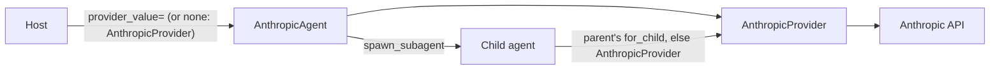
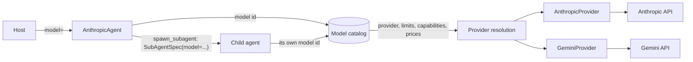
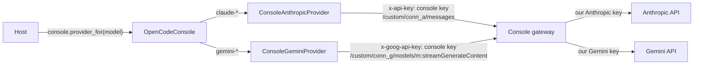

# Models from several providers

Touches: `agent_base/providers/gemini/` (new), `agent_base/providers/opencode_console/` (new), `agent_base/core/model_catalog.py` (new), `agent_base/providers/__init__.py`, `agent_base/providers/anthropic/anthropic_agent.py`, `agent_base/common_tools/sub_agent_tool.py`, `agent_base/pricing/models.csv`, `agent_base/pricing/calculator.py`, `pyproject.toml`, `tests/unit/providers/gemini/` (new), `tests/unit/providers/opencode_console/` (new), `tests/interface/providers/`, `tests/integration/providers/opencode_console/` (new), `mental_model/subsystems/providers.md`, `mental_model/subsystems/sub-agents.md`, `mental_model/features/billing-a-run.md`, `mental_model/infrastructure/external-services.md`, `mental_model/infrastructure/packaging-and-release.md`

Today every agent's model calls go to Anthropic, directly or through Claude Code; [LiteLLM](../subsystems/providers.md#litellm) reaches other models with known gaps. This item lets an agent, or one of its sub-agents, run on a model from another provider and keep everything the harness does: tools, pauses, aborts, compaction, sub-agents, frames and settlement. Only the [provider](../subsystems/providers.md) changes. It starts with Google's Gemini format beside the Anthropic one, both reached through OpenCode Console with our own keys, and adds a model catalog that tells the harness which format serves each model.

> **Why through OpenCode Console:** to test models now on our own Anthropic and Gemini keys, while the free models can't be used, and later reach more models through a Console subscription by adding them to the same architecture (the developer, 17 Nov 2026).

**Prototype status (17 Nov 2026):** built on branch `saanvi/opencode-console-provider` ahead of this item's review, at the developer's request. Offline tests pass against scripted stand-ins for both APIs; the live tier waits for a Console workspace. Where the prototype differs from what follows, the section says so.

> **Why a provider per API, not a gateway library:** going through OpenRouter or LiteLLM loses capabilities the harness is built on, such as context management (the developer, 17 Nov 2026).

> **Why:** to plug in sub-agents for specific jobs, such as summarization or classification, on whichever model suits them, and use them as is (the developer, 17 Nov 2026).

> **Why Gemini first:** its models are reachable with a free Gemini API key, beside the paid Anthropic key (the developer, 17 Nov 2026).

## Where it sits

Before: the host picks the provider by hand, and a sub-agent runs on Anthropic unless its parent's provider says otherwise.



After: the model names the provider, through the catalog. A child can run on a different provider from its parent.



A child keeps its own history, so one model's thinking never reaches another model: Claude's thinking blocks and Gemini's thought signatures are each replayed only to the model that wrote them.

## The model catalog (new)

One record per model id. The provider reads it to shape requests, the [turn loop](../subsystems/turn-loop.md) to size compaction, and the pricing policy to price steps.

```python
ModelRecord(
    id: str,                     # the id the API takes: "claude-haiku-5-5", "gemini-3.8-flash"
    provider: str,               # "anthropic", "gemini"; later "openai_chat"
    context_tokens: int,
    output_tokens: int,
    inputs: frozenset[str],      # "text", "image", "pdf", "audio", "video"
    tools: ToolSupport,          # parallel calls, forced tool choice, strict schemas
    reasoning: ReasoningSupport, # effort levels, whether it can be off
    structured_output: bool,
    caching: Literal["breakpoints", "implicit", "none"],
    prices: PriceRow | None,     # per 1M tokens: input, output, cache read, cache write
)
```

- The library ships records only for models whose live tier passed (below). A host can add or override records.
- **A field a model can't honour** follows the rule the [Claude Code provider](claude-code-provider.md) set: refused when the provider is built if it changes what the agent can do (a server tool, PDF input on a text-only model), logged once per session if it only tunes the request (a cache setting, an effort level the model lacks).

## The Gemini provider (new)

`GeminiProvider` and `GeminiLLMConfig`, in `providers/gemini/`, for Google's generateContent format. It implements the `Provider` protocol, which is unchanged. The history stays in the harness's own blocks, and the provider translates at the edge. It speaks plain HTTP through `httpx`, not Google's Gen AI SDK: a gateway serves the API's own paths under another base URL, which a raw client reaches without patching an SDK, and it adds no dependency (`httpx` comes with the Anthropic SDK). The same class serves the Gemini Developer API directly (`GEMINI_API_KEY`) and any gateway; only the base URL, key and auth header differ. The field names below are the ones the prototype sends; the live tier confirms them:

| The harness | The Gemini API |
|---|---|
| System prompt | `systemInstruction` |
| User and assistant messages | `contents`, roles `user` and `model`; consecutive contents of one role merged on the wire only |
| `TextContent` | a text part |
| `ThinkingContent` | a thought part (`thought: true`), with its `thoughtSignature` in `signature` |
| Thought signatures on other parts | kept in the block's `kwargs["thought_signature"]`, sent back only to the model that wrote them |
| `ToolUseContent`, `ToolResultContent` | `functionCall` and `functionResponse` parts, matched by id; a call Gemini sent without an id gets one that never goes back on the wire |
| A tool result | `response: {"output": ...}`, or `{"error": ...}` for an error; images it returned as parts beside it |
| `ImageContent`, `DocumentContent` | `inlineData` (base64) or `fileData` (a URL); an Anthropic Files API id is refused |
| Tool schemas | `functionDeclarations` with `parametersJsonSchema`, which takes JSON Schema unchanged |
| `effort` | `thinkingLevel` (`xhigh` and `max` become `high`); `thinking_tokens` is `thinkingBudget` |
| `max_tokens` | `maxOutputTokens` |
| Finish reason | `STOP` → `end_turn` (`tool_use` when calls came back), `MAX_TOKENS` → `max_tokens`, safety reasons and a blocked prompt → `refusal` |
| Usage | prompt, output, thought and cached token counts; thought tokens are billed as output |

**Stream translation** produces the frames the Anthropic provider does: `text` and `thinking` as they arrive with one closing frame per block, one `tool_call` frame per call with its full arguments (Gemini sends a call whole). Citations and server-tool frames wait for phase 3.

**A failure mid-stream:** before any frame went out, the call is retried; after, the provider keeps what streamed and returns it with `partial_error`, so the client never sees the same text twice.

**Errors and retries:**

| Gemini failure | `ErrorCode` |
|---|---|
| 429, quota exhausted | `RATE_LIMITED`, retried after Google's hinted delay (`RetryInfo`), at most 60 s |
| 500, 503 | `PROVIDER_OVERLOADED`, retried |
| Timeout, connection error | `PROVIDER_TIMEOUT`, retried |
| 400 for a prompt over the context window | `CONTEXT_OVERFLOW`: the turn loop compacts and retries |
| Other status errors | `PROVIDER_STATUS` |

**Caching:** Gemini caches repeated prefixes on its own, so the provider places no breakpoints. The harness's byte-stable history still keeps those prefixes stable.

**Not in phase 1:** Anthropic's server tools, skills and containers are refused on Gemini when the config is landed (a sub-agent spec that copies its parent's Anthropic config with `server_tools` fails to build). Fields that only tune an Anthropic request (`beta_headers`, `context_management`, …) are dropped and logged. Gemini's own built-in tools (Google Search grounding, URL context, code execution) and its explicit context cache are phase 3.

## OpenCode Console (new)

`OpenCodeConsole`, in `providers/opencode_console/`: a Console workspace's service-account key and its **connections**, one per provider connected under Console's Providers. Console serves each connection at `https://opencode.ai/inference/custom/<connection_id>` in that provider's own format, swaps the service-account key for the provider's key, and forwards the request unchanged. The provider bills the tokens; Console charges no credits for them.



- **`provider_for(model)`** asks the catalog for the model's format and returns that format's provider pointed at its connection: `ConsoleAnthropicProvider` (an `AnthropicProvider` whose client's base URL is the connection) or `ConsoleGeminiProvider`.
- **The Anthropic path:** the SDK asks for `<base_url>/v1/messages`; Console serves the format at `<connection>/messages`. A transport under the client drops the `/v1`.
- **Sub-agents:** each Console provider's `for_child(spec)` returns the provider for the spec's model, so a child on Gemini runs under a parent on Claude, both through Console. A spec with no model stays on its parent's format, never on the direct API key.
- **One client per format for the workspace,** shared by every provider it builds, sub-agents included. The host closes them with `console.aclose()`; a provider never does.
- **Set up from the environment** with `OpenCodeConsole.from_env()`: `OPENCODE_CONSOLE_API_KEY`, and `OPENCODE_CONSOLE_ANTHROPIC` and `OPENCODE_CONSOLE_GOOGLE`, each a connection id or the Console API URL copied from the provider's page.
- **Files the API hosted** (code execution's outputs) are not fetched: a connection doesn't serve the Files API.

Console's own paid models (Zen) and the Go plan serve the same formats at other base URLs (`/inference/anthropic/v1/messages`, `/inference/go/...`), so reaching them is a base URL and catalog records, not a new provider.

## Changes to existing characters

**[Providers](../subsystems/providers.md): resolution from the model.** An `AnthropicAgent` built without `provider_value=` asks the catalog which provider serves its `model` and builds that provider with its key. `provider_value=` still wins, so Claude Code and any host-built provider work as today. *Prototype: not built. The host passes `provider_value=console.provider_for(model)`.*

**[Sub-agents](../subsystems/sub-agents.md): a child's model picks its provider.** `SubAgentSpec(model="gemini-3.8-flash", ...)` builds the child on `GeminiProvider` under a parent on Claude. A spec with no model, or one from the parent's provider, keeps today's rule: the parent's `for_child`, else `AnthropicProvider`. *Prototype: done through the providers' `for_child` (Console's and `GeminiProvider`'s); `SubAgentTool` is unchanged.*

**[Billing a run](../features/billing-a-run.md):** `pricing/models.csv` gains rows for the catalogued Gemini models, at their paid prices. A child on Gemini settles and reports its steps through the parent's usage callbacks, as any child does. *Prototype: no rows yet, so Gemini steps cost zero and log `unknown_model_for_cost`. The table has no `claude-haiku-5-5` row either, so its steps cost zero today too.*

**[Compaction and externalization](../subsystems/turn-loop.md):** unchanged. The summary call goes through the provider's `side_calls()`, so a Gemini child summarises on Gemini. Token estimation on Gemini starts with the character heuristic the other non-Anthropic providers use.

**[Packaging](../infrastructure/packaging-and-release.md):** no new extra: the Gemini provider needs only `httpx`, which the Anthropic SDK already brings. It should become a direct dependency, since the library now imports it itself.

## Keys

Through Console, one service-account key calls every connection; the provider keys stay in the workspace and never reach the harness. Directly, each provider reads its own key: `ANTHROPIC_API_KEY` and `GEMINI_API_KEY`, or a key or client the host passes. Console adds a hop, and a third party that sees the prompts.

## The conformance tier

One spec that every provider passes, so "supported" means the same thing for every model.

| Behaviour | Checked |
|---|---|
| A plain reply, streamed | Frames in order, the final message, usage |
| A tool round, parallel tool calls, a tool error | Results matched to calls by id |
| A frontend tool's pause and resume | The run resumes with the reply |
| An abort mid-stream | `plan_stream_abort` keeps what it should |
| A prompt over the context window | `CONTEXT_OVERFLOW`, then compaction and a retry |
| A sub-agent on another provider | The child's answer and settlement reach the parent |
| An image input, structured output | Where the model's record says it can |
| A rate limit, a server error | Retried within the `RetryPolicy` |

- **Offline**, in `tests/interface/providers/`, against a scripted stand-in for each API. *Prototype: `tests/unit/providers/gemini/` and `tests/unit/providers/opencode_console/`, with `httpx` mock transports for both APIs, including a tool round and a Gemini sub-agent under a Claude parent through the agent.*
- **Live**, in `tests/integration/providers/<provider>/`, marked `integration` and opt-in by environment flag. A model's record ships once its live tier passes. *Prototype: `tests/integration/providers/opencode_console/`. `AGENT_BASE_LIVE_OPENCODE_CONSOLE=1` runs the Gemini checks (free on a free key); `AGENT_BASE_LIVE_CONSOLE_PAID=1` adds the Claude ones, which bill the Anthropic key.*

## Phases

1. The catalog, the Gemini provider, the Console route, sub-agent resolution and the conformance tier. Live on `claude-haiku-5-5` (paid key) and two models on Gemini's free tier, `gemini-3.8-flash` and `gemini-3.1-flash-lite`, all through Console.
2. A provider for OpenAI-compatible Chat Completions, the API most other models speak: DeepSeek, GLM, Qwen, Kimi, MiniMax, and the models Console sells. Console's paid models (Zen) and Go then need only a base URL and records.
3. Each provider's own server tools, Gemini's explicit cache, and resolution from the model without `provider_value=`.

## Open questions

For the developer, before the build:

1. A model with no catalog record: refuse it, or keep today's default of `AnthropicProvider`?
2. Where records come from: written by hand in the library, or seeded from the open models.dev catalog and then checked by the live tier?
3. LiteLLM and the any-llm stub (`providers/any_llm/`, every behaviour still `NotImplementedError`): keep LiteLLM for models with no provider of their own, and finish or remove any-llm?
4. A child on another provider under a Claude Code parent: does its model's provider win over the parent's `for_child`, as above?
5. A free key's steps: priced at the paid rows, or does the host mark the key as free in its `pricing_policy`?
6. One agent switching provider mid-session: out of scope, or should chain repair drop other models' thinking so it can? (The Gemini provider already drops another model's thinking and signatures on the wire.)
7. Console and Anthropic's betas: context management rides the `anthropic-beta` header. If Console drops it, a Claude agent on Console loses context management; the live tier records which.
8. Gemini's free key through Console: Console sees the prompts as well as Google. Acceptable for made-up test data only?

## Contracts

- **New public names:** `GeminiProvider`, `GeminiLLMConfig`, `ModelRecord`, `ModelCatalog`, `OpenCodeConsole`, `ConsoleAnthropicProvider`, `ConsoleGeminiProvider`, and later the resolution function.
- **`SubAgentSpec.model`** now also picks the child's provider.
- **`Provider`** and `ProviderLifecycle` are unchanged.
- Every change is additive for a host that passes `provider_value=` or uses Claude models only. Nova consumes this package; it changes nothing until it puts a sub-agent on Gemini, which it would plan in its own repo.

## Depends on

- **The Gemini Developer API**, with an API key, over `httpx`. On the free tier, requests are rate-limited and Google uses the prompts to improve its products, so the free key suits only public or made-up test data.
- **OpenCode Console's Providers API:** a connection's URL, the service-account key in `x-api-key` or `x-goog-api-key`, the format's own paths, and requests forwarded unchanged. Assumes Console streams back the provider's own SSE.
- **Anthropic Python SDK**, unchanged; the Console path rewrite assumes it sends `<base_url>/v1/messages`.
